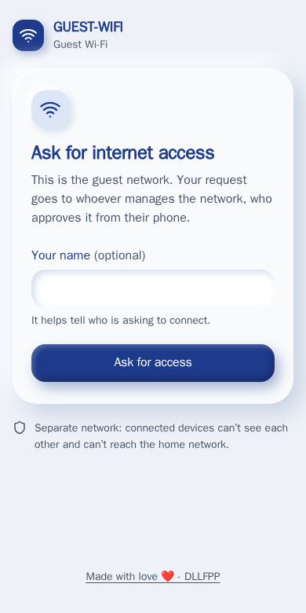
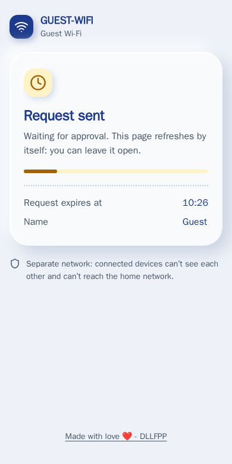
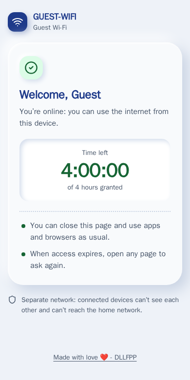
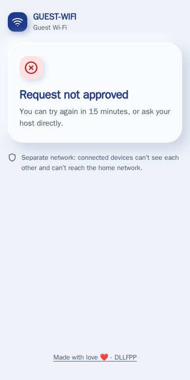

# UniFi Guest Approval Portal

An external captive portal for **Ubiquiti UniFi** guest Wi-Fi where every new device has to be
**approved by the owner on Telegram**. The guest asks for access (name optional) and waits; the owner
gets a message with the device details and taps **✅ 4 hours · ✅ 24 hours · ⏱ Hours… · ❌ Reject**, and can
**⛔ Revoke** an approved device later. A pinned message with one button **opens or closes** the guest
Wi-Fi without touching the access points.

**[Try the live demo →](https://dllfpp.github.io/unifi-guest-portal/)** (runs in your browser, with a simulated
controller and a simulated Telegram).

Works with the **UniFi Network** application in both flavours, detected automatically:

- **UniFi OS** consoles (UDM, UDR, UCG, Cloud Key Gen2+, UniFi OS Server): `https://<console>`;
- **self-hosted Network Application** (Docker, Linux, Windows): `https://<host>:8443`.

The same project exists for TP-Link Omada: [omada-guest-portal](https://github.com/dllfpp/omada-guest-portal).

- **Server-side pages, no JavaScript**, one stylesheet. The waiting page reloads by itself; after approval the
  guest sees a welcome page with a live **countdown** of the time left (pure CSS), and when it reaches zero
  the page moves to "Access ended".
- **English by default, Italian when the guest's browser prefers it** (`Accept-Language`, with the right
  `<html lang>`); `?lang=en|it` forces one. Telegram messages to the owner follow `TG_LANG` (`en` or `it`).

## Screenshots

<table>
  <tr>
    <td></td>
    <td></td>
  </tr>
  <tr>
    <td></td>
    <td></td>
  </tr>
</table>

What the owner receives on Telegram (demo data):

```
📶 GUEST-WIFI · access request
👤 Name: Guest
📱 Device: iPhone · Apple
🔖 MAC 02-00-00-00-00-01
📡 AP: AP-LIVING
🕒 14:32 · expires without an answer at 14:42
[ ✅ 4 hours ] [ ✅ 24 hours ] [ ⏱ Hours… ]
[ ❌ Reject ]
```

**⏱ Hours…** makes the bot ask *"For how many hours should I approve Guest?"* as a forced reply: answer with
a whole number from 1 to 720 (30 days) and the device is approved for that long. An invalid number gets the
question again; each question can be answered once, and only by `TG_ADMIN`.

**Open / close the guest Wi-Fi.** At startup the bot pins a message in the chat/topic with one button,
**🔒 Close guests** or **🔓 Open guests**. While closed, the network stays on and visible but the portal shows
*"Guest Wi-Fi closed"* and accepts no new requests; devices already approved keep their access until it
expires. Changing the WiFi network itself would re-provision every access point and briefly drop all the
other wireless networks too.

## How it works

```
guest joins the hotspot network ─▶ AP redirects to the External Portal Server (this service, port 80)
   /guest/s/<site>/?id=<client MAC>&ap=<AP MAC>&t=…&url=…&ssid=…
guest taps "Ask for access" ─▶ POST /richiesta ─▶ Telegram message with buttons
owner taps ✅ ─▶ POST <controller>/api/s/<site>/cmd/stamgr  {"cmd":"authorize-guest","mac":…,"minutes":…}
waiting page reloads ─▶ /benvenuto?id=… (welcome + countdown) ─▶ at zero: "Access ended"
```

- **Login** with a local admin account: `POST /api/auth/login` and `/proxy/network/api/…` with the
  `X-CSRF-Token` header on UniFi OS, `POST /api/login` and `/api/…` on a self-hosted controller. The session
  is renewed by itself when it expires.
- **Authorization** is `authorize-guest` with the duration in **minutes**; the controller answers with the
  expiry, which the welcome page counts down to. **Revoke** is `unauthorize-guest`, which also works for a
  device that is not connected right now.
- **Device details** (name, vendor, AP, network) come from `stat/sta`. A request from a device the controller
  sees on a different network is refused; so is a redirect whose `ssid` is not the configured one.
- The `url` that UniFi passes is usually the operating system's connectivity probe
  (`captive.apple.com/hotspot-detect.html`, `msftconnecttest.com/redirect`), not the page the guest wanted,
  so the portal never sends guests there: after approval they land on the portal's own welcome page.
- Rules: a request with no answer expires after 10 minutes, after a rejection the same device waits 15 minutes,
  at most 5 requests can wait at the same time. All configurable.

## UniFi setup

Menu names are those of UniFi Network 8, 9 and 10.

1. **Local admin for the portal** (*Settings › Admins & Users*; on UniFi OS *Control Plane › Admins & Users*):
   a **local** account, not a UI.com account, **without two-factor authentication**, with a role that can
   manage the Network application (*Site Admin* is enough; a read-only role cannot approve guests).
2. **Hotspot** (*Settings › Hotspot*, or *Insights › Hotspot Manager › Settings* on older versions):
   authentication **External Portal Server**, with the **IP address** of this service.
   UniFi only takes an IP address and always sends guests to **port 80**, so the portal must answer on port 80
   (the `compose.yml` maps `80:8097`).
3. **Pre-authorization access** (same page): add the IP address of this service. By default UniFi blocks the
   private networks (`10/8`, `172.16/12`, `192.168/16`) for guests that are not approved yet, the portal included.
4. **WiFi**: an open network for guests with **Hotspot Portal** (guest network) turned on.

## Telegram

Create a **dedicated bot** with [@BotFather](https://t.me/BotFather) and press *Start* in its chat. The
portal reads the bot with long polling, so nothing else (Home Assistant, n8n, …) may read the same bot:
the buttons would fail with `409 Conflict`.

- **Private chat**: set `TG_CHAT` (and `TG_ADMIN`) to your user id.
- **Group with topics**: add the bot as an admin, set `TG_CHAT` to the group id and `TG_TOPIC` to the topic
  name. The Bot API cannot list topics, so the portal learns the topic id from the first message written in
  it and confirms there; until then requests go privately to `TG_ADMIN`. Or set `TG_THREAD` directly.
- Buttons work for anyone pressing them in the configured chat/topic, and for `TG_ADMIN` everywhere.
- The bot can keep Telegram's privacy mode on: it only needs button presses and replies to its own messages.
  To pin the open/close message it needs the *Pin messages* admin right.

## Install and set up

```sh
docker compose up -d --build
docker logs unifi-guest-portal           # shows the one-time setup code
```

Open `http://<docker-host>/` in a browser, enter the setup code and follow the wizard:

1. **Controller**: its address and the local account; the wizard signs in, detects UniFi OS or a self-hosted
   controller and reads the version.
2. **Site** and **guest network**, chosen from the lists read from the controller; a network without Hotspot
   Portal gets a warning.
3. **Telegram bot**: create it with @BotFather and paste the token; the wizard refuses a bot that already
   has a webhook (another program is using it).
4. **Chat**: write to the bot, or in the group/topic where it is an admin, and press *Find chats*; the
   wizard lists them, you pick one and it sends a test message.
5. **Rules**, then a summary with what is still to do in the controller (hotspot and pre-authorization access,
   with this server’s address filled in). Save, and the portal starts right away in the same container.

The wizard is protected by the setup code printed in the log (it runs on the same port the guests can reach)
and switches off once the configuration is saved. The configuration lives in `/data/config.json` on the
volume (readable only by the container user).

- **Change the configuration later**: `docker exec unifi-guest-portal touch /data/setup`, then
  `docker restart unifi-guest-portal`; the wizard opens again with the current values.
- **Environment variables instead of the wizard**: copy `.env.example` to `.env` and fill it in; values from
  the environment take precedence over `config.json`. See [`.env.example`](.env.example) for every option.

```sh
curl -s http://localhost/salute          # health: requests waiting, open/closed, Telegram, topic in use
docker logs -f unifi-guest-portal        # requests, approvals, button presses
```

Preview the welcome page with fake data (no state, no controller calls):
`/anteprima/benvenuto?nome=Guest&ore=4&secondi=90` (add `&lang=it` for Italian; at zero it moves to `/anteprima/terminata`).

## Tests and demo

```sh
node --test test/*.test.js   # portal flow, languages, Telegram topics, setup wizard and first start,
                             # with a fake controller and a fake Telegram
node demo/build.js           # rebuilds the static demo in docs/ (GitHub Pages)
```

The demo in `docs/` uses the real code: the guest pages and the Telegram message are generated in the browser
by `src/lingue.js`, `src/pagine.js` and `src/messaggi.js` (bundled by `demo/build.js`), and the wizard pages are
recorded from the real wizard running against the fake controller of the tests.

## What has been tested

- Against a real **UniFi Network Application 10.6** (self-hosted): login, wrong password, sites, WiFi networks,
  `authorize-guest` for a given number of hours (the controller reports the exact expiry), `unauthorize-guest`,
  lookup of an unknown device.
- **Not yet tested**: a **UniFi OS** console (the login and the `/proxy/network` prefix follow the documented
  API), and the redirect of a real access point. If something differs on your setup, the log shows the
  parameters received (`parametri non validi …`): please open an issue with them.

## Notes and limits

- The countdown needs CSS `@property` (iOS 16.4+, Chrome 85+, Firefox 128+); older browsers show the
  starting value without moving.
- Style: "Clay" (claymorphism), one stylesheet with design tokens at the top, `src/stile.css`.

## License

[MIT](LICENSE)

---

Made with love ❤️ - DLLFPP · [Buy me a coffee](https://buymeacoffee.com/dllfpp)
